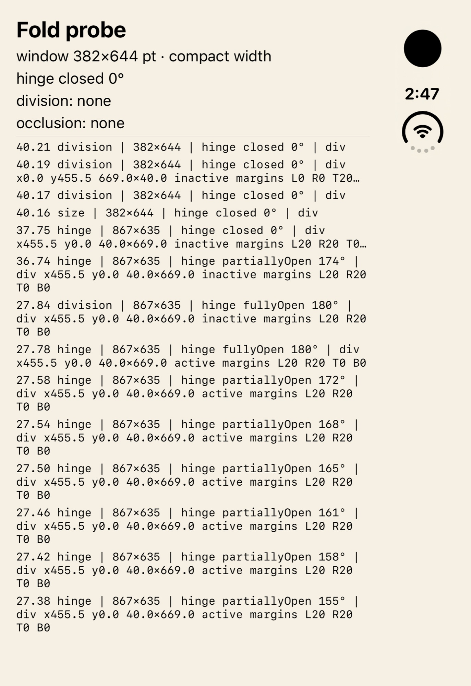

**Quick answer:** the iPhone Duo's outer screen is **466 × 678 points**, but only **382 × 644** is yours. An 84-point status column runs down the right edge and 34 points are reserved at the bottom. It's **compact width**, like an iPhone in portrait. Corners are rounded on the right and **square on the hinge side**. Design it as the main screen, because that's how people use the phone most of the time.

I've been [using an iPhone Duo since launch](/blog/first-few-days-with-iphone-duo/), and after a week I [still used it folded more than unfolded](/blog/top-5-iphone-duo-apps-after-one-week/). Most iPhone Duo advice is about the big inner display. This post is about the screen people actually look at most. The measurements come from a probe app I ran in Apple's Xcode 27.1 simulator.



## The numbers

| | Outer display |
|---|---|
| Size | 466 × 678 pt, portrait |
| Pixels | 1398 × 2034 (@3x) |
| Safe area | 0 top, 0 left, 34 bottom, **84 right** |
| Usable area | **382 × 644 pt** |
| Size classes | Compact width, regular height |
| Corners | 59 pt radius on the right, square on the left (hinge) side |
| Fold region | None |

For the inner display and the transitions between them, see my [iPhone Duo screen sizes post](/blog/iphone-duo-screen-sizes-and-layout-notes-for-developers/).

## 1. Start from your iPhone layout, then check the width

The outer screen has the same size classes as an iPhone in portrait, so your iPhone layout is the right starting point. But **382 points of usable width is less than current iPhones give you.** That's because the time and status icons sit in a column down the right edge instead of a bar across the top.

Things worth checking at that width:

- Rows with a label, a value and a button side by side.
- Anything with a fixed width sized for a 390- or 402-point screen.
- Tab bars and toolbars with lots of items.

Check every screen at 382 points wide, and let text wrap instead of truncating.

## 2. Use the height you got back

There's no status bar across the top, so the top safe area is 0. Your content can start right at the top of the screen. I put toolbars about 16 points from the top edge. The status column also only takes up the top-right corner visually, so a full-bleed background or photo can run under it.

## 3. Respect the square corners

The outer screen's mask is **rounded on the right and square on the left**, where the hinge is. A closed book with its spine on the left has exactly this shape. That makes a full-bleed design look good on the outer screen. It also means anything you center visually can look off if you center it in the safe area instead of the whole screen.

For Lampleaf, the outer screen shows a leather Bible cover. I center the gilt title on the full 466-point width, not the 382-point safe area. Centered in the safe area, it looked shifted toward the hinge.

## 4. Make it the main app, not a preview

Because I use the phone folded so much, I design the outer screen as the full app, not a teaser for the inner one:

- **Lampleaf** is fully readable folded, one page at a time. Opening the phone turns it into a two-page spread with Scripture on the left and a companion page on the right.
- **My document scanner** goes camera-first on the outer screen, since you hold the phone closed to scan. The two-pane review layout appears when it's open.
- **My platformer game** uses a tall layout on the outer screen, with the game on top and a control deck below. Opening the phone switches it to a separate wide layout.

In each case the app decides from its window size, not from which screen it's on.

## 5. Plan for the move between screens

Opening or closing the phone doesn't relaunch your app. The same scene moves to the other display, `scenePhase` stays active, and state is kept. When I closed the simulator, the hinge reported closed about **2.4 seconds** before the app's window moved to the outer screen. Make sure the scroll position, the open item and any half-typed text come along. How to react to the hinge is in [handling the iPhone Duo fold in SwiftUI](/blog/how-to-handle-the-iphone-duo-fold-in-swiftui/).

## 6. The outer screen while the phone is open

While the phone is open, the outer screen is **off**, and your app can't draw there normally. iOS 27.1 adds one exception: a **camera capture accessory**. In SwiftUI it's the `CameraCaptureAccessory` scene accessory, attached with the `sceneAccessory` modifier:

```swift
@available(iOS 27.1, *)
struct CameraScreen: View {
    var body: some View {
        CameraControls()
            .sceneAccessory {
                CameraCaptureAccessory {
                    Text("Look here")
                }
            }
    }
}
```

That compiles against the 27.1 SDK, but I haven't seen it run, because the simulator has no camera. As far as I understand it, the accessory only appears during camera capture, so it's for things like a "look here" prompt for the person being photographed, not a second screen for any app. Check Apple's documentation before you plan a feature around it.

## Testing it

The outer screen is easy to skip because the simulator opens on the inner display. My [simulator testing guide](/blog/how-to-test-your-app-in-the-iphone-duo-simulator/) covers folding it. Also note that `simctl` screenshots of the outer screen came out black for me. When it's time for the App Store, the outer screen gets its own [screenshot size, 1398 × 2034](/blog/iphone-duo-app-store-screenshot-sizes/).

*Measured in Apple's Xcode 27.1 simulator in October and November 2026. Values may differ on hardware or change in later iOS versions. iPhone is a trademark of Apple Inc.*
