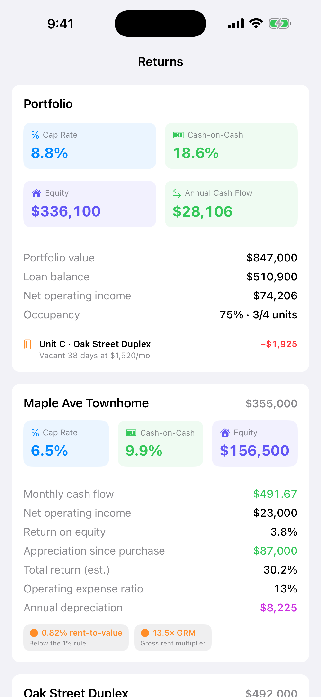

import CapRateCalculator from '../../components/CapRateCalculator.astro';

You found a listing and the rent looks good. But is it actually a good deal?

Cap rate is the quickest way to compare one rental property to another, whether or not they have a mortgage. It answers one question: *for every dollar this property is worth, how much does it earn in a year before financing?*

## The formula

> **Cap rate = Net operating income ÷ Property value**

**Net operating income (NOI)** is the property's yearly income minus its yearly operating expenses:

> **NOI = Gross rent − Vacancy − Operating expenses**

Use the purchase price when you're evaluating a deal. Use a current estimated value when you're checking a property you already own.

## Try it

Plug in your own numbers. Everything runs in your browser.

<CapRateCalculator />

## A worked example

A single-family rental worth **$250,000** rents for **$2,000 a month**.

1. **Gross rent:** $2,000 × 12 = **$24,000**
2. **Vacancy allowance:** 5%, about $1,200. Few rentals are occupied every day of every year.
3. **Operating expenses:** property taxes, insurance, repairs, maintenance and lawn care come to **$7,500**.
4. **NOI:** $24,000 − $1,200 − $7,500 = **$15,300**
5. **Cap rate:** $15,300 ÷ $250,000 = **6.1%**

## What to leave out of NOI

This is where most cap-rate math goes wrong. NOI is about the property, not how you paid for it or how you file taxes. So leave out:

- **Mortgage payments.** Principal and interest are financing, not operating costs. That's what lets you compare a paid-off property with a leveraged one.
- **Depreciation.** It's a tax deduction, not cash leaving your account.
- **Capital improvements.** A new roof or a remodel is a one-time investment, not a yearly operating cost.
- **Your income taxes.**

Do include property taxes, insurance, repairs, routine maintenance, HOA dues, management fees (even if you self-manage, some investors include one to compare fairly), and utilities you pay.

## What's a good cap rate?

It depends on the market and the property. Lower cap rates are common in expensive, in-demand areas where values are expected to rise. Higher cap rates are common where prices are lower and risk is higher. A cap rate is most useful for comparing similar properties in the same area, and for tracking your own properties year to year.

## Cap rate vs. cash-on-cash return

Cap rate ignores financing on purpose. **Cash-on-cash return** brings it back in. It's your yearly cash flow after the mortgage, divided by the cash you actually put in (down payment, closing costs, initial repairs).

A property can have a modest cap rate and a strong cash-on-cash return because of the loan, or the other way around. Look at both.

Two other quick screens investors use:

- **The 1% rule:** is monthly rent at least 1% of the price? $2,000 on $250,000 is 0.8%.
- **Gross rent multiplier (GRM):** price ÷ yearly gross rent. $250,000 ÷ $24,000 ≈ 10.4.

Neither replaces real NOI, but both help you sort through listings fast.

## How Rental Manager helps

Rental Manager is an iPhone app for landlords who manage their own properties. Its **Returns** screen calculates cap rate, cash-on-cash return, NOI, cash flow and equity from the rent and expenses you've already recorded. You get them for each property and for the whole portfolio.

Capital improvements and mortgage payments are kept out of NOI, the way the formula above calls for. The screen also shows the 1% rule, gross rent multiplier and operating expense ratio, and it flags vacant units and what they're costing you.

*Demo data.*

Your numbers stay current because they come from what you log, not a spreadsheet you update once a year.

**[Download Rental Manager: Rent & Taxes on the App Store](https://apps.apple.com/us/app/rental-manager-rent-taxes/id6758280423)**
