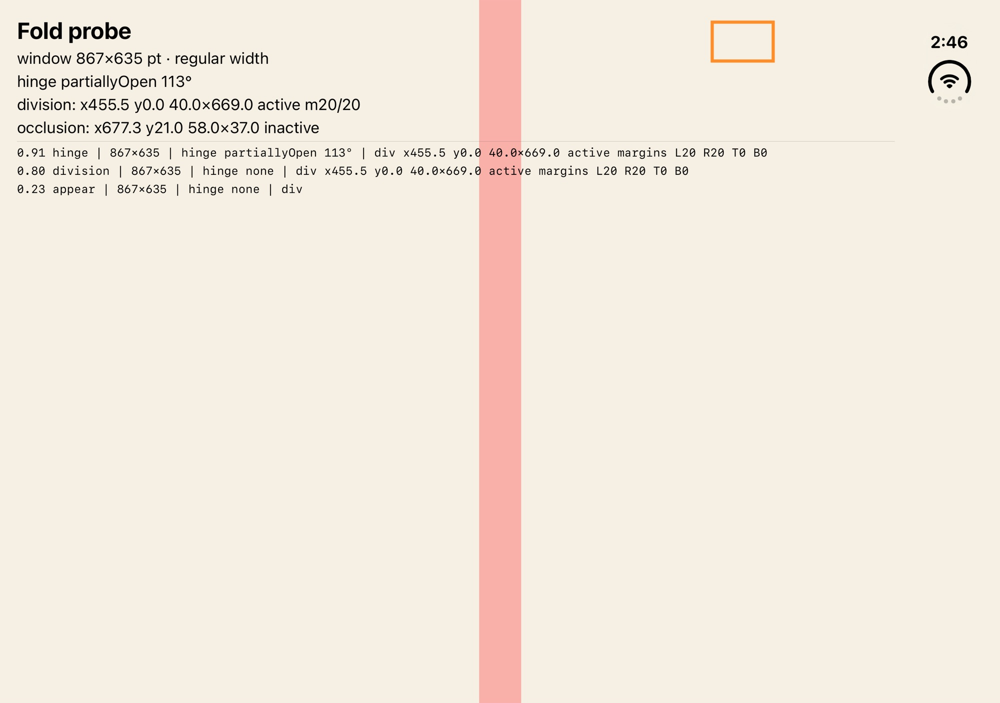
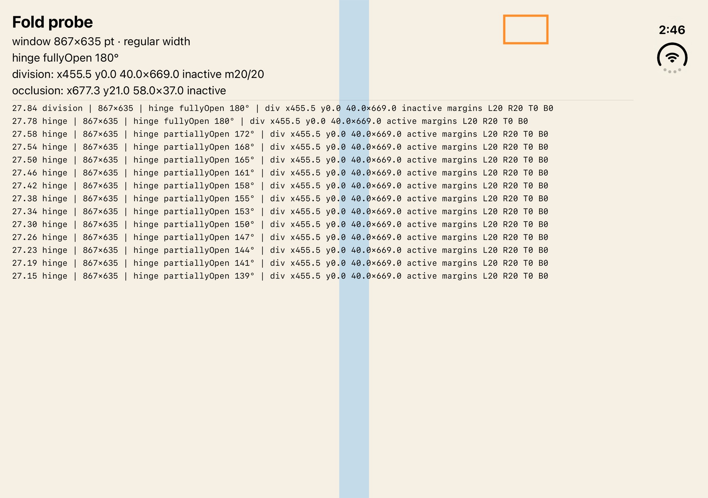

**Quick answer:** decide your layout from the **window size**, as you would on an iPad. Then use two iOS 27.1 APIs for the fold itself:

- **`GeometryProxy.reservedRegions(kind: .division)`** tells you where the crease is while the phone is half open, so you can keep content off it.
- **`onHingeChange`** reports the hinge's status and angle, so you can start an animation before the window resizes.

I build [Lampleaf](/lampleaf/), a Bible app that opens like a book on the iPhone Duo, so I care a lot about the fold. To write this post, I built a small probe app that draws the division region and logs every hinge and size change. I then ran it through each pose in Apple's iPhone Duo simulator (Xcode 27.1, build 27A9275) on November 26, 2026. All the code below compiles against the iOS 27.1 SDK.

## 1. Pick the layout from the window

The window size tells you what you have to work with. On the inner display, my app's window is 951 × 669 points. On the outer display it's 466 × 678. iPads and Split View give you other sizes again, and this handles all of them:

```swift
struct ReaderView: View {
    var body: some View {
        GeometryReader { geo in
            if geo.size.width >= 700 && geo.size.width > geo.size.height {
                TwoPageView()
            } else {
                OnePageView()
            }
        }
    }
}
```

Don't check the device model, and don't use `UIScreen.main`. In the simulator, `UIScreen.main` keeps pointing at the outer display even when the app is on the inner one.

## 2. Find the fold with the division region

The fold is a **division** region. You ask the `GeometryProxy` for it:



This is what I measured on the inner display:

| Pose | Hinge | Division region | Active? |
|---|---|---|---|
| Half open | partiallyOpen, 102° to 113° | x 455.5, 40 × 669 pt | **Yes** |
| Fully open | fullyOpen, 180° | x 455.5, 40 × 669 pt | No |
| Closed (outer display) | closed, 0° | none | – |

So the fold is a **40-point strip, centered at x 475.5**, the middle of the 951-point inner display, and the full height of the screen. It also reported margins of 20 points on each side. I haven't found Apple guidance on exactly how to use those margins.

The most useful detail: the region is **only active while the phone is half open.** That's when the crease matters, because the two halves are at an angle. When the phone lies flat, a default query returns nothing, and your normal layout runs. To see the region in every pose, pass `options: .includeInactive`.



Here's a two-pane layout that stays off the fold when there is one:

```swift
struct SplitAtFold: View {
    var body: some View {
        GeometryReader { geo in
            if #available(iOS 27.1, *),
               let fold = geo.reservedRegions(kind: .division).first {
                HStack(spacing: 0) {
                    LeftPane().frame(width: fold.frame.minX)
                    Spacer().frame(width: fold.frame.width)
                    RightPane()
                }
            } else {
                HStack(spacing: 0) { LeftPane(); RightPane() }
            }
        }
    }
}
```

In my probe the region's frame lined up with the window, but it's 669 points tall while a `GeometryReader` inside the safe area is 635. Test this against your own view hierarchy.

There's also an **occlusion** kind for hardware that covers the screen. My probe saw one near the top of the inner display, marked inactive in every pose I tried.

## 3. Use the hinge to get ready, not for layout

`onHingeChange` calls you with the old and new `DeviceHingeContext`. Its `hinge` has a `status` (`.closed`, `.partiallyOpen` or `.fullyOpen`) and an `angle`, and is `nil` on devices without a hinge. This wrapper also works on older iOS versions:

```swift
extension View {
    @ViewBuilder
    func onFoldStart(_ action: @escaping () -> Void) -> some View {
        if #available(iOS 27.1, *) {
            self.onHingeChange { _, new in
                guard let hinge = new.hinge else { return }  // nil on phones without a hinge
                if hinge.status == .partiallyOpen { action() }
            }
        } else {
            self
        }
    }
}
```

Why not use it for layout? Here's the timeline when I opened the phone from closed:

| Time | Event |
|---|---|
| 0.00 s | Hinge `closed`, 9° |
| 0.04 s | Hinge `closed`, 15° (still reported as closed) |
| 0.74 s | Hinge `partiallyOpen`, 30° |
| 1.01 s | Hinge `partiallyOpen`, 93° |
| 1.22 s | Window resizes to 466 × 562 (a brief in-between size) |
| 1.40 s | Window settles at the inner display size |
| 1.52 s | Division region turns active, hinge at 102° |

The hinge moved for **more than a second before the window changed.** When I closed the phone, the hinge read 0° about 2.4 seconds before the app moved to the outer display. That's useful lead time for rendering a cover or loading a two-page spread, but the window size is what tells you which layout to show.

On the hinge updates themselves: while the simulator swung open, I got an update about every 40 milliseconds, roughly 3° apart. The simulator animates the hinge itself, so a real phone in your hand will behave differently. Don't depend on the update rate.

## 4. Ignore the in-between sizes

During that opening, the window briefly reported **466 × 562** before settling. My Lampleaf notes from October also caught **951 × 553**. If your layout switches on every size change, those can flash the wrong layout for a frame. I wait for the size to settle:

```swift
struct SettledLayout<Content: View>: View {
    @ViewBuilder var content: (CGSize) -> Content
    @State private var settled: CGSize = .zero

    var body: some View {
        GeometryReader { geo in
            content(settled == .zero ? geo.size : settled)
                .task(id: geo.size) {
                    try? await Task.sleep(for: .milliseconds(150))
                    settled = geo.size
                }
        }
    }
}
```

## UIKit

The UIKit equivalent is `UIHingeInteraction`, also iOS 27.1:

```swift
@available(iOS 27.1, *)
func addHinge(to view: UIView) {
    let interaction = UIHingeInteraction { _, update in
        guard let hinge = update.hinge else { return }
        print(hinge.status == .partiallyOpen, hinge.angle)
    }
    view.addInteraction(interaction)
}
```

`UIView` has a matching reserved-regions query (`reservedRegionsOfKind:` in the Objective-C header) for the division region.

## Related

- [How to test your app in the iPhone Duo simulator](/blog/how-to-test-your-app-in-the-iphone-duo-simulator/): setup, folding and recording.
- [iPhone Duo screen sizes and layout notes](/blog/iphone-duo-screen-sizes-and-layout-notes-for-developers/): every display size and safe area.
- [iPhone Duo App Store screenshot sizes](/blog/iphone-duo-app-store-screenshot-sizes/), from six live apps.
- Apple: [Preparing your app for iPhone Duo](https://developer.apple.com/documentation/technologyoverviews/preparing-your-app-for-iphone-duo) and the Tech Talk [Strike a pose with adaptive layouts](https://developer.apple.com/videos/play/tech-talks/111463/).

*Measured in Apple's Xcode 27.1 simulator on November 26, 2026. Values may differ on hardware or change in later iOS versions. iPhone is a trademark of Apple Inc.*
