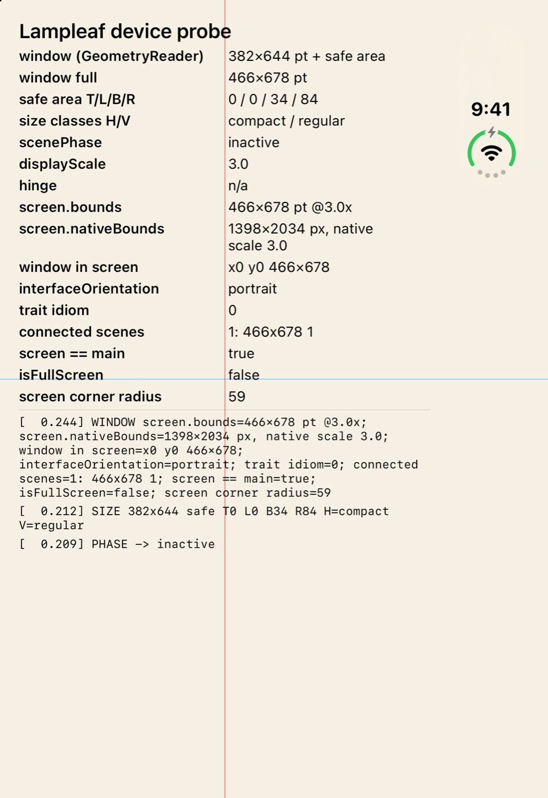
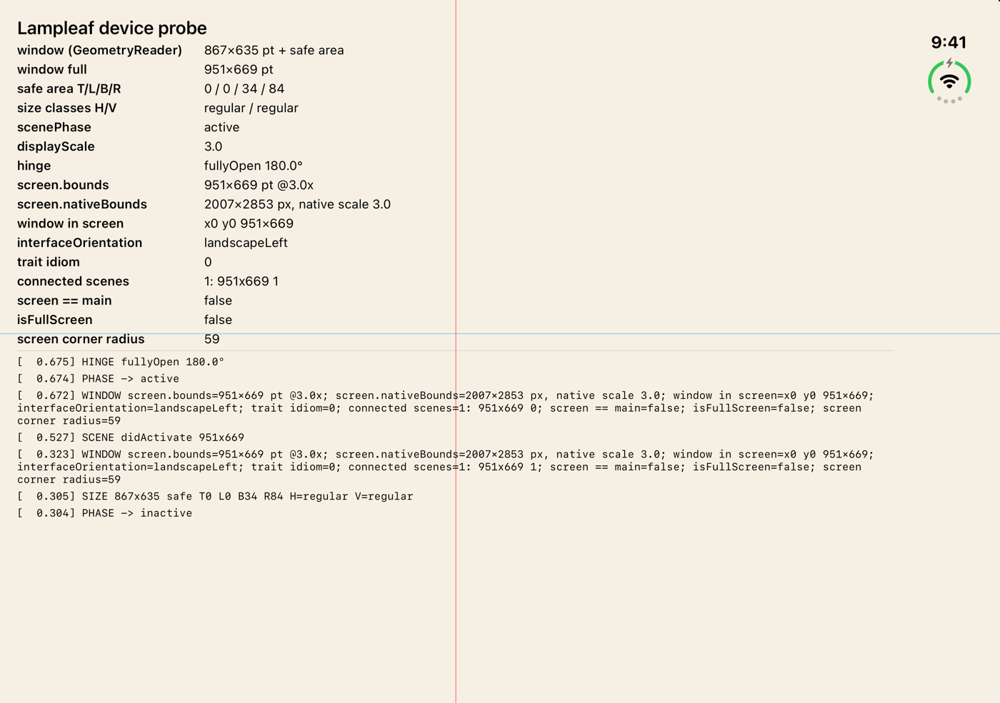

**Quick answer:** install Xcode 27.1 or later with the iOS 27.1 runtime, run your app on the **iPhone Duo** simulator, and use the controls in **Device Hub** to fold and unfold it. There's no `simctl` command for folding, so you fold by hand. Check the outer display, the inner display, the fold in both directions and Split View. If your screenshots of the outer display come out black, that's the simulator, not your app.

I've been building several apps for the iPhone Duo, including [Lampleaf](/lampleaf/), a Bible app laid out like an open book, [Sousbook](/blog/sousbook-iphone-duo-recipe-book/), a recipe book, and [Beige Box](/blog/beige-box-tiny-retro-computers-iphone-duo/), tiny retro computers. Most of that work happened in Apple's simulator, before and after the phone shipped on October 23. This is the testing routine I ended up with and the problems I hit along the way.

The measurements are from Xcode 27.1 (build 27A9275) in October 2026, and I rechecked the device type and `simctl` commands on November 26. Apple may change things in later versions.

## 1. Get the simulator

- **Install Xcode 27.1 or later.** Apple says apps need it to use the whole screen on iPhone Duo. Apps built with older SDKs still run, but [won't adapt to every layout](https://developer.apple.com/iphone-duo/prepare/).
- **Install the iOS 27.1 runtime.** The iPhone Duo device type comes with it. On my Mac it's listed as `com.apple.CoreSimulator.SimDeviceType.iPhone-Duo`.
- **If it's missing from the run destinations,** add a simulator yourself and choose iPhone Duo as the device type with the 27.1 runtime. Other developers have hit this too: there's an Apple forum thread titled [Cannot find iPhone Duo simulator in Device Hub](https://developer.apple.com/forums/thread/845171).
- **You can keep another Xcode installed.** Before 27.1 was final, I installed it as a second copy next to my main Xcode. Command-line tools use whichever copy you point `DEVELOPER_DIR` at:

```bash
export DEVELOPER_DIR="/Applications/Xcode copy.app/Contents/Developer"
xcrun simctl list devicetypes | grep -i duo
```

## 2. Fold and unfold it

The iPhone Duo simulator opens in Device Hub with controls along the bottom to close, open and half-open the phone. Holding Option gave me a slider for the hinge angle.

Two things to know:

- **You can't script the fold.** `simctl` in Xcode 27.1 has no fold or posture command, so any test that needs the phone closed means clicking the button yourself. I batch every folded check into one session.
- **Don't power off a display with `simctl io … screenConfig`.** When I tried that on the iPhone Duo, SpringBoard went into a crash loop. Shutting the simulator down and booting it again fixed it.

## 3. What to check on each screen

These are the screens, measured with a small probe app I wrote. For the full numbers, see my [iPhone Duo screen sizes post](/blog/iphone-duo-screen-sizes-and-layout-notes-for-developers/).





| | Outer display | Inner display |
|---|---|---|
| Size | 466 × 678 pt, portrait | 951 × 669 pt, landscape |
| Size class | Compact width | Regular width |
| Safe area | 84 pt down the right edge, 34 pt at the bottom | Same |
| `windowScene.screen == UIScreen.main` | true | **false** |

My checklist:

1. **Outer display.** Does your iPhone layout fit 382 points of usable width? That's what's left after the 84-point column on the right, which is narrower than most iPhones.
2. **Inner display.** Do you use the extra width, or just stretch a phone layout? I switch to a two-column layout when the window is at least 700 points wide and wider than it is tall.
3. **Opening and closing.** The same scene moves between the displays. `scenePhase` stays active and your state survives, so you shouldn't lose a form or a scroll position. If you do, something in your code is tied to the screen.
4. **The in-between sizes.** On opening, the window briefly passed through 466 × 562 and 951 × 553 before settling at 951 × 669, all within about 130 milliseconds. If your layout switches on every size change, you may see it flash. I wait for the size to settle before switching layouts.
5. **`UIScreen.main`.** It keeps pointing at the outer display even when your app is on the inner one. Anything that reads it for layout will be wrong when unfolded. Read the window or a `GeometryReader` instead.
6. **Split View.** Two apps can share the inner display, so your app needs to work at about half its width.

**The hinge API fires early.** In iOS 27.1, SwiftUI's `onHingeChange` and UIKit's `UIHingeInteraction` report the hinge angle. In the simulator, the hinge started opening about 1.7 seconds before the window resized. That's useful for getting an animation ready, but don't use it for layout. The simulator's slider is also much jumpier than a real hinge, so don't depend on how often it updates.

## 4. Screenshots and recordings

- **The inner display records fine.** List the displays, then record the one you want:

```bash
xcrun simctl io booted enumerate
xcrun simctl io booted recordVideo --display=<inner display ID> inner.mov
```

- **The outer display came out black** for me with both `screenshot` and `recordVideo`. I capture the simulator window for those shots instead.
- **Check the rotation of inner-display recordings.** Some of mine came out portrait with no rotation data. `ffmpeg -vf transpose=1` fixed them.
- **Record a video to check animations.** A still frame hid a broken unfold animation in one of my apps. The video showed it right away.
- **For App Store screenshots,** App Store Connect gave me one iPhone Duo set that holds both outer and inner display shots, up to 10 total. Shoot both, not just the big screen.

## 5. Things the simulator can't tell you

- **The outer display while the phone is open.** It turns off when the phone opens. Other apps can't draw on it, except through a camera accessory API that needs an active camera session.
- **How the crease feels.** Everything above is from the simulator. Since I got my own phone, things like a control sitting right on the fold are easier to judge in your hand.
- **Real hinge speed and battery.** Test on hardware before you trust either.

If you're a user rather than a developer, my [guide to telling whether an app is ready for the iPhone Duo](/blog/how-to-tell-if-an-app-is-ready-for-iphone-duo/) is the non-technical version. Everything else I've written about the phone is on the [iPhone Duo topic page](/topics/iphone-duo/).

## Apple's resources

- [Three steps to make your app shine on iPhone Duo](https://developer.apple.com/iphone-duo/prepare/)
- [Preparing your app for iPhone Duo](https://developer.apple.com/documentation/technologyoverviews/preparing-your-app-for-iphone-duo)
- Tech Talk: [Prepare your app for iPhone Duo](https://developer.apple.com/videos/play/tech-talks/111461/)

*Measured in Apple's Xcode 27.1 simulator; results may change with software updates or differ on hardware. iPhone is a trademark of Apple Inc. My apps aren't affiliated with or endorsed by Apple.*
