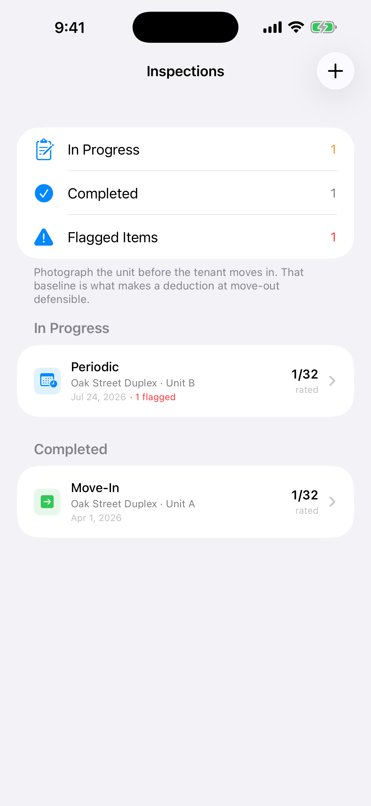

A tenant moves out after two years. There's a burn mark on the counter and a hole in the bedroom wall. They say both were there when they moved in.

Without a move-in record, it's your word against theirs. With one, it takes about a minute to settle.

The move-in inspection is the record that makes a fair security deposit deduction possible later. Here's a room-by-room checklist, and how to document each item so it holds up.

## How to do the inspection

1. **Walk it with the tenant if you can.** Two people agreeing on condition on day one avoids most disputes on the last day.
2. **Rate every item.** Use a simple scale like excellent, good, fair, poor or damaged, so "fair" means the same thing at move-in and move-out.
3. **Photograph anything that isn't excellent,** plus a wide shot of every room. Make sure the photos are dated.
4. **Write a short note for every flaw.** "2-inch scratch on counter left of sink" beats "some wear."
5. **Both sign and date it,** and give the tenant a copy.
6. **Repeat the same checklist at move-out,** in the same order, so you're comparing like with like.

## The checklist

Copy this, print it, or use it as the template in whatever you keep records in.

### Kitchen
- [ ] Appliances (stove, oven, fridge, dishwasher, microwave). Do they work, and are they clean?
- [ ] Cabinets and drawers
- [ ] Countertops
- [ ] Sink and faucet: leaks, drainage
- [ ] Flooring
- [ ] Walls and ceiling

### Living room
- [ ] Flooring or carpet
- [ ] Walls and ceiling
- [ ] Windows, screens and blinds
- [ ] Lighting
- [ ] Outlets and switches

### Each bedroom
- [ ] Flooring or carpet
- [ ] Walls and ceiling
- [ ] Closet: doors, rods, shelves
- [ ] Windows, screens and blinds
- [ ] Lighting

### Each bathroom
- [ ] Toilet: flush, base, seat
- [ ] Tub or shower
- [ ] Sink and vanity
- [ ] Flooring
- [ ] Ventilation fan
- [ ] Caulking and grout

### Systems
- [ ] HVAC: runs and cools/heats, filter date
- [ ] Water heater
- [ ] Smoke and carbon monoxide detectors: test each one
- [ ] Plumbing: visible leaks under sinks
- [ ] Electrical panel

### Exterior
- [ ] Roof (from the ground)
- [ ] Siding and paint
- [ ] Gutters
- [ ] Yard
- [ ] Fence and gates

Add rooms as needed: dining room, hallway, laundry, garage, basement.

Also record the **meter readings, the keys and remotes handed over,** and the **date of the inspection**.

## Normal wear and tear vs. damage

At move-out, the question is usually whether something is **normal wear and tear** or **damage**. Normal wear generally can't come out of a deposit. Damage generally can.

- Lightly worn carpet in walkways after two years: wear.
- A pet stain or a burn in the carpet: damage.
- Faded paint, a few small nail holes: generally wear.
- A hole in the drywall: damage.

Your move-in photos are what turn "damage" from an opinion into evidence.

## Security deposit deadlines

States set their own deadlines and rules for returning deposits and itemizing deductions. In Texas, where I own rentals, the deadline is generally 30 days after the tenant surrenders the unit. Some other states are shorter. Look up your state's rules before your first move-out, not during it.

## How Rental Manager helps

Rental Manager is an iPhone app for landlords who manage their own properties. Its **Inspections** screen starts move-in, move-out, periodic and drive-by inspections from a room-by-room template like the one above. You can add rooms and items as needed.

Each item gets a condition rating, a note and photos. The app shows how many items are rated and flags anything poor or damaged.

*Demo data.*

Inspections attach to the property and unit, so at move-out the move-in record is right there to compare against. Photos and data stay on your device.

**[Download Rental Manager: Rent & Taxes on the App Store](https://apps.apple.com/us/app/rental-manager-rent-taxes/id6758280423)**
