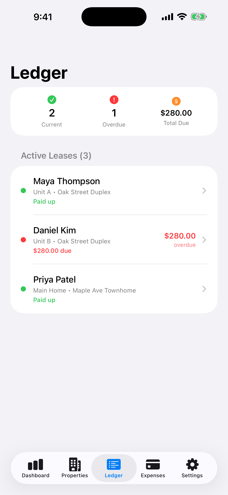

If a tenant ever says "I paid that," the rent ledger is how you both find out. It's also what you'll want in front of you when you file taxes, when a tenant asks for a payment history, and when a dispute goes further than a conversation.

Most small landlords start with bank statements and memory. That works until the first partial payment. Here's what a rent ledger is, what to put in it, and a free template you can start using today.

## What is a rent ledger?

A rent ledger is a running record of everything you **charge** a tenant and everything they **pay**, with the balance after every line. You may also hear it called a tenant ledger or a rent payment ledger. They're the same idea.

It is different from:

- **A rent roll.** A snapshot of all your units on one date: who lives where, the monthly rent, and each balance.
- **A general ledger.** The full books for the whole property or business, including expenses. Your [expense records](/blog/how-to-track-rental-property-expenses-without-dreading-tax-time/) live there, not in the rent ledger.

## The columns a rent ledger needs

| Column | Why it matters |
| --- | --- |
| **Date** | When the charge was due or the payment arrived. |
| **Tenant, property and unit** | So a ledger never gets mixed up with another lease. |
| **Entry type** | Rent charge, payment, late fee, credit, or other charge. |
| **Description** | "November rent," "Partial payment," "Late fee per lease section 4." |
| **Charge** | Amounts the tenant owes. |
| **Payment** | Amounts the tenant paid. |
| **Running balance** | Previous balance + charges − payments. Positive means they owe you. |
| **Method** | Check, transfer, cash, payment app. |
| **Reference** | Check number or transaction ID. This is your proof. |
| **Notes** | Anything you'd want to remember in a year: promises, waivers, conversations. |

## A rent ledger example

Here is one month for a tenant who paid late and in two parts.

| Date | Entry | Charge | Payment | Balance |
| --- | --- | --- | --- | --- |
| Nov 1 | November rent | $1,450 | | $1,450 |
| Nov 3 | Partial payment (transfer) | | $1,000 | $450 |
| Nov 6 | Late fee per lease | $75 | | $525 |
| Nov 9 | Balance paid (check #2210) | | $525 | $0 |
| Dec 1 | December rent | $1,450 | | $1,450 |

Anyone can read that and see exactly what happened, including you, a year from now.

## Rules that keep a ledger trustworthy

1. **Charges and payments are separate lines.** Post the full rent on the due date, then post each payment as it arrives. Never edit the rent amount down to match what was paid.
2. **One ledger per lease.** When a tenant moves out and a new one moves in, start a new ledger. Roommates on the same lease share one.
3. **Never delete a line.** If you made a mistake, add a correcting entry with a note. A ledger with gaps is hard to defend.
4. **Late fees only as your lease allows.** Post them as their own charge, with the lease section in the description. Check your state and local rules on late fees and grace periods.
5. **Security deposits live somewhere else.** A deposit you may have to return isn't rent. Track the amount, date, where it's held, and any move-out deductions with receipts in a separate record.
6. **Record it the day it happens.** A ledger updated weekly is accurate. A ledger rebuilt in April from bank statements usually isn't.

## Free rent ledger template

**[Download the free rent ledger template (CSV)](/templates/rent-ledger-template.csv)**

It opens in Excel, Google Sheets, or Numbers. It has every column above and a few sample rows that show a partial payment and a late fee. Delete the sample rows, and add a formula for the running balance: in Sheets or Excel, the first balance cell is `=G2-H2`, and each one after it is `=I2+G3-H3` filled down.

Keep one tab or file per lease, and save a copy at the end of every year.

## When a spreadsheet stops being enough

A spreadsheet ledger works for one or two units. It gets fragile when you have to remember to add every month's rent charge yourself, when you're copying the same formula across ten tabs, or when a tenant asks for a statement and you're formatting one by hand.

That's why I built **Rental Manager** for my own properties. It creates rent charges automatically, records full or partial payments, and shows balances and overdue rent for every lease. You can generate rent receipts and tenant statements from the ledger. Security deposits, deductions, and return deadlines are tracked separately, the way they should be.

*Demo data.*

Everything stays on your iPhone, with no account and no subscription. The same app tracks expenses by [Schedule E line](/blog/how-to-fill-out-schedule-e-for-a-rental-property/), so rent and expenses end up in one tax-year packet. I wrote more about the leases side in [how to keep track of leases and late rent](/blog/how-to-keep-track-of-leases-and-late-rent-as-a-self-managing-landlord/).

**[Download Rental Manager: Rent & Taxes on the App Store](https://apps.apple.com/us/app/rental-manager-rent-taxes/id6758280423)**

*This is a general guide for self-managing landlords, not legal or tax advice. Late fee, deposit and record-keeping rules vary by state and city.*
