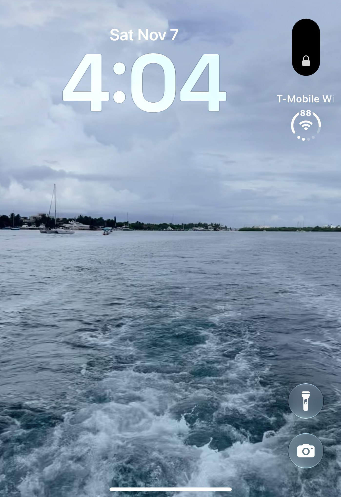
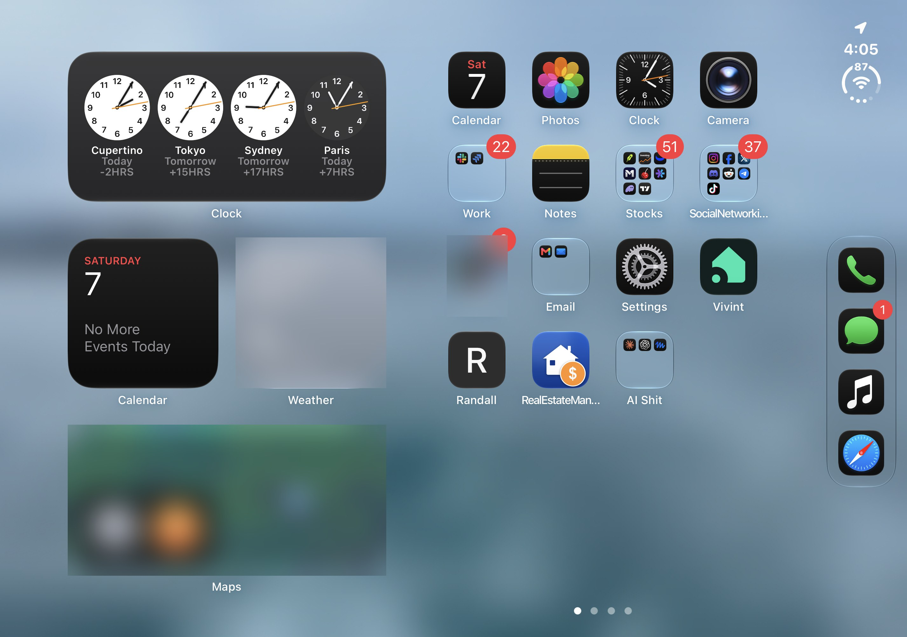

I have now been using my iPhone Duo for about a week. In [my first few days with it](/blog/first-few-days-with-iphone-duo/), I said I would have more to say after spending longer with the phone, so here is where things stand.

## A Week In

**The battery has still been great.** That was my early impression, and it has held up.

**I also still use it folded more than unfolded.** I have the option to open it up, but folded is how I find myself using it.

## My Top 5 iPhone Duo Apps So Far

These are the best apps I have come across so far that support the Duo.

1. **YouTube.** The video app you already know.
2. **Netflix.** Same story, for movies and shows.
3. **[PianoFold](https://apps.apple.com/us/app/pianofold-rhythm-game/id6822806944).** A piano rhythm game.
4. **Plants vs. Zombies.** The classic tower defense game.
5. **[Structured](https://apps.apple.com/us/app/structured-daily-planner-todo/id1499198946).** A daily planner and to-do app.

## My Own Apps That Support the iPhone Duo

These four are mine, so I kept them out of the list above. They support the Duo too, so I wanted to include them.

- **[Sousbook](/sousbook/).** A recipe organizer and personal cookbook. On the wider display, you can follow cooking steps with the ingredients beside them.
- **[Lampleaf](https://apps.apple.com/us/app/lampleaf-illustrated-bible/id6824583357).** An illustrated Bible app that [recently went live](/blog/lampleaf-is-live-and-a-full-week-at-home/). On the Duo it opens like a book: fold it shut for a leather cover, unfold it for a two-page spread.
- **[Rise & Capy](https://apps.apple.com/us/app/rise-capy/id6804264261).** A capybara alarm clock with wake-up missions. Its layouts adapt as you open, close, or rotate the phone.
- **[FamilyStop](https://apps.apple.com/us/app/familystop-family-restrooms/id6782247307).** Helps parents and caregivers find family-friendly stops, like a bathroom or changing table. Its layouts now adapt to the Duo as well.

## Apps Still Missing iPhone Duo Support

Some big apps still do not have support for the Duo:

- **TradingView**
- **Chase**
- **T-Mobile**
- **Instacart**

That is where these stand for me as of this week, and it may change as more apps add support.

If you are trying to figure out whether an app you use is ready, I wrote up [a simple way to tell if an app is ready for the iPhone Duo](/blog/how-to-tell-if-an-app-is-ready-for-iphone-duo/). And if you are building for it, here are my [iPhone Duo screen size and layout notes](/blog/iphone-duo-screen-sizes-and-layout-notes-for-developers/).

So far, I am happy with the phone. The battery has been great, I keep using it folded, and I have come across some good apps for it.
