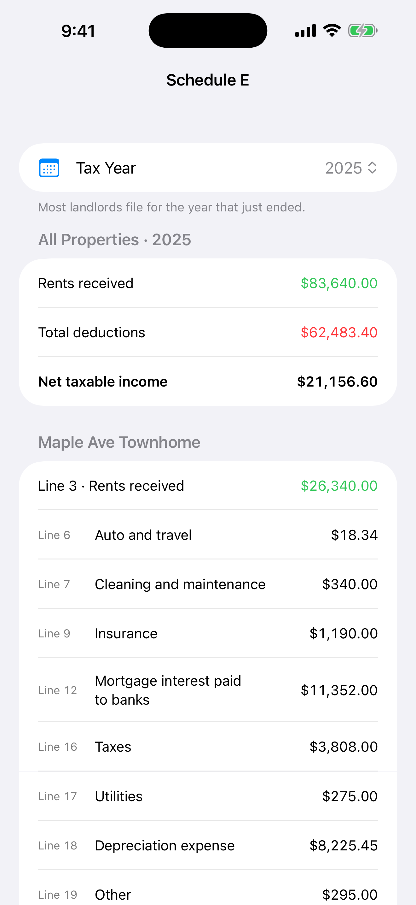

The rental deductions that slip away are the ones you never wrote down: the mileage to the property, the lock they replaced, the depreciation line they never filled in.

Here's a checklist of the common costs landlords deduct, the ones that aren't deductible right away, and the records that make each one easy to claim. It's a general guide for self-managing landlords, not tax advice. Run your specific situation by a tax professional.

## The general rule

Ordinary and necessary costs of managing, maintaining and renting out a property are generally deductible in the year you pay them. Costs that *improve* the property, or that you'll benefit from for years, are generally depreciated over time instead.

## Common deductible rental expenses

Each of these lines up with a line on [Schedule E](/blog/how-to-fill-out-schedule-e-for-a-rental-property/).

- [ ] **Mortgage interest.** Interest only. Your lender's Form 1098 has the number.
- [ ] **Property taxes.** The tax on the rental property itself.
- [ ] **Insurance.** Landlord, liability, flood. Prepaid multi-year policies are spread over the years covered.
- [ ] **Repairs.** Fixing something that broke: a leaking pipe, a broken window, a dead outlet.
- [ ] **Cleaning and maintenance.** Turnover cleaning, lawn care, pest control, HVAC servicing.
- [ ] **Utilities you pay.** Water, trash or electricity you cover for the tenant.
- [ ] **HOA dues.** For properties in an association.
- [ ] **Property management fees.** If someone else handles any part of it.
- [ ] **Advertising.** Listing sites, signs, background-check or screening services you pay for.
- [ ] **Legal and professional fees.** Eviction attorneys, lease reviews, the rental portion of your tax prep.
- [ ] **Travel to the property.** Driving to show a unit, meet a contractor or pick up supplies. Track miles as you go: date, trip and purpose.
- [ ] **Supplies.** Smoke detector batteries, light bulbs, air filters.
- [ ] **Depreciation.** The building (not the land) is generally depreciated over 27.5 years for residential rentals, plus any improvements you've made. This is often the largest deduction, and it's the one most often missed.

Expenses for a vacant property you're actively trying to rent are generally deductible too.

## What isn't deductible (at least not right away)

- **Mortgage principal.** It's paying down your loan, not an expense.
- **Improvements.** A new roof, a remodel, a new HVAC system. These are capitalized and depreciated. There are IRS safe harbors that let smaller purchases be expensed. One example is the de minimis safe harbor for items up to $2,500 per invoice or item, if you make the election. Ask your preparer whether they apply to you.
- **The land.** Land isn't depreciated, so split your purchase price between land and building.
- **Your own time.** You can't deduct the value of your own labor, only what you actually pay out.
- **Personal use.** If you or family use the property part of the year, expenses get split between rental and personal days.

## Repair or improvement? A quick gut check

Ask what the work did:

- **Restored** something to how it was? Usually a repair.
- **Made it better** than it was before, **adapted** it to a new use, or **replaced** a major component? Usually an improvement.

Replacing a few shingles is a repair. Replacing the roof is an improvement. When it's close, write down what you did and why, and let your preparer make the call.

## The records to keep

For every expense, keep:

1. **The date and amount**
2. **The vendor** you paid
3. **Which property and unit** it was for
4. **A category** that maps to a Schedule E line
5. **The receipt or invoice**

The category is the step people skip, and it's the one that saves the most time in April. If every expense is categorized when you log it, your totals by line are already done.

I wrote a fuller routine in [how to track rental property expenses without dreading tax time](/blog/how-to-track-rental-property-expenses-without-dreading-tax-time/).

## How Rental Manager helps

Rental Manager is an iPhone app for landlords who manage their own properties. Each expense you log is tied to a property, a unit and a category. Each category maps to its Schedule E line. Capital improvements are kept separate, so they don't get counted as current-year deductions. Mortgage interest and principal are tracked separately, and the app estimates depreciation from your purchase details.

*Demo data.*

At year end, the **Schedule E** screen shows each property's totals by line, ready to review with your tax preparer. The app organizes your records. It doesn't decide what's deductible for you or give tax advice.

**[Download Rental Manager: Rent & Taxes on the App Store](https://apps.apple.com/us/app/rental-manager-rent-taxes/id6758280423)**
